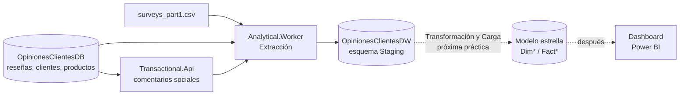

# CustomersOpinions — Sistema de Análisis de Opiniones de Clientes con ETL

Proyecto de la materia **Electiva 1 (ITLA)** — Docente: Francis Ramirez.
Estudiante: Cesar Augusto Diaz Morillo | 2025-1962

Una empresa de comercio electrónico quiere analizar lo que sus clientes opinan de sus productos en tres canales:

| Canal | Tecnología | Contenido |
|---|---|---|
| Archivos CSV | Sistema de archivos | Encuestas internas de satisfacción |
| Base de datos relacional | SQL Server (`OpinionesClientesDB`) | Reseñas publicadas en el sitio web |
| API REST | ASP.NET Core Web API | Comentarios en redes sociales |

Los datos se consolidan en una base de datos analítica (`OpinionesClientesDW`, modelo estrella) mediante un proceso ETL construido con un Worker Service de .NET 8 y, al final, se visualizan en un dashboard.

---

## Estructura del repositorio

El repositorio contiene **una sola solución** (`CustomersOpinions.sln`) dividida en dos partes:

| Parte | Propósito | Base de datos |
|---|---|---|
| **Transactional** | Carga los seis CSV de origen en la base transaccional (práctica anterior) y expone los comentarios sociales mediante una API REST. | `OpinionesClientesDB` |
| **Analytical** | ETL hacia el data warehouse. **Alcance actual: solo Extracción** (CSV + base de datos + API → tablas staging). | `OpinionesClientesDW` |

El código (proyectos, namespaces, clases, comentarios y mensajes) está en **inglés**; la documentación está en **español**.

```
/
├── CustomersOpinions.sln               solución única (carpetas de solución: Transactional, Analytical, Tools)
├── Directory.Build.props               configuración de compilación compartida (net8.0, nullable, warnings como errores)
├── README.md                           este archivo
├── AGENTS.md                           plan de trabajo y reglas para el agente de programación
├── data/
│   ├── csv/                            los seis CSV originales
│   ├── csv-dirty/                      CSV con errores sembrados (evidencia de validación de la parte transaccional)
│   └── performance/                    archivo generado de 50.000 encuestas (ignorado por git)
├── database/
│   ├── transactional/                  scripts de OpinionesClientesDB (01–03 existentes, 04 objetos de extracción)
│   └── analytical/                     scripts de OpinionesClientesDW (01 modelo estrella, 02 staging, 03 procedimientos de carga)
├── src/
│   ├── Transactional/
│   │   ├── README.md
│   │   ├── CustomersOpinions.Transactional.Data/     librería de carga CSV → OLTP (ADO.NET + procedimientos almacenados)
│   │   ├── CustomersOpinions.Transactional.Load/     aplicación de consola que ejecuta la carga
│   │   └── CustomersOpinions.Transactional.Api/      API REST que publica los comentarios sociales
│   └── Analytical/
│       ├── README.md                                 ← especificación técnica completa del ETL
│       ├── CustomersOpinions.Analytical.Domain/
│       ├── CustomersOpinions.Analytical.Application/
│       ├── CustomersOpinions.Analytical.Infrastructure/
│       └── CustomersOpinions.Analytical.Worker/
├── tools/
│   └── CustomersOpinions.Tools.SurveyGenerator/      genera el archivo de 50.000 filas para la prueba de rendimiento
└── docs/
    └── diagrams/                                     diagramas de arquitectura y de flujo del ETL
```

## Flujo de la solución



## Estado

| Etapa | Estado |
|---|---|
| Modelo transaccional y carga de los CSV | Terminado (práctica anterior) |
| Modelo analítico (estrella) | Terminado (`database/analytical/01_CreateDataWarehouse.sql`) |
| **Extracción (CSV, base de datos, API → staging)** | **En curso — práctica actual** |
| Procedimientos almacenados de carga (dimensiones, TVP, bulk) | Scripts listos (`database/analytical/03_LoadProcedures.sql`) |
| Componentes C# de transformación y carga (ADO.NET → procedimientos) | Próxima práctica |
| Dashboard | Práctica final |

## Requisitos

- SDK de .NET 8
- SQL Server 2019+ (instancia local) y SSMS
- Visual Studio 2022 17.8+ o VS Code con C# Dev Kit

## Inicio rápido

1. Crear las bases de datos en SSMS, en este orden:
   1. `database/transactional/01_CreateDatabase.sql`, `02_Programmability.sql`, `04_ExtractionObjects.sql`
   2. `database/analytical/01_CreateDataWarehouse.sql`, `02_CreateStaging.sql`, `03_LoadProcedures.sql`
   3. Precargar los miembros por defecto del DW: `exec OpinionesClientesDW.dbo.usp_SeedDimensionMembers;`
2. Cargar la base transaccional: `dotnet run --project src/Transactional/CustomersOpinions.Transactional.Load`
3. Configurar los secretos (cadenas de conexión y API key): ver `src/Analytical/README.md` §9.
4. Iniciar la API: `dotnet run --project src/Transactional/CustomersOpinions.Transactional.Api --launch-profile https`
5. Ejecutar la extracción: `dotnet run --project src/Analytical/CustomersOpinions.Analytical.Worker`

El detalle de cada parte está en `src/Transactional/README.md` y `src/Analytical/README.md`.
