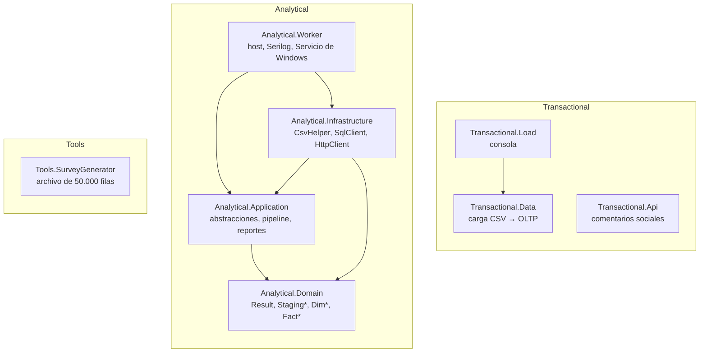
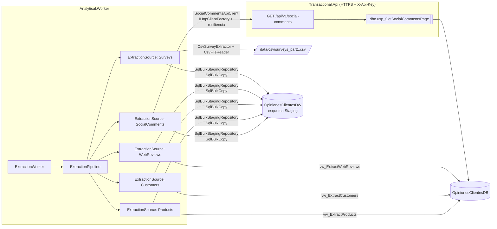
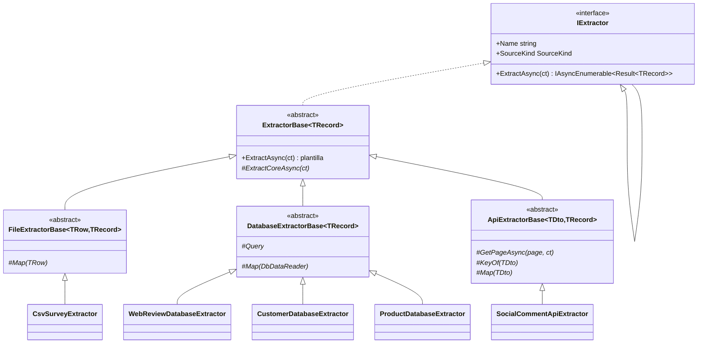

# Arquitectura de la solución

Diagramas en Mermaid (se ven directamente en GitHub y en VS Code con la extensión de Mermaid).

## Proyectos y regla de dependencias

Las flechas indican "referencia a". Domain no referencia nada; Application solo a Domain; el Worker es la raíz de composición. La API se despliega por separado y no referencia a ningún otro proyecto.

## Componentes en ejecución

## Jerarquía de extractores

