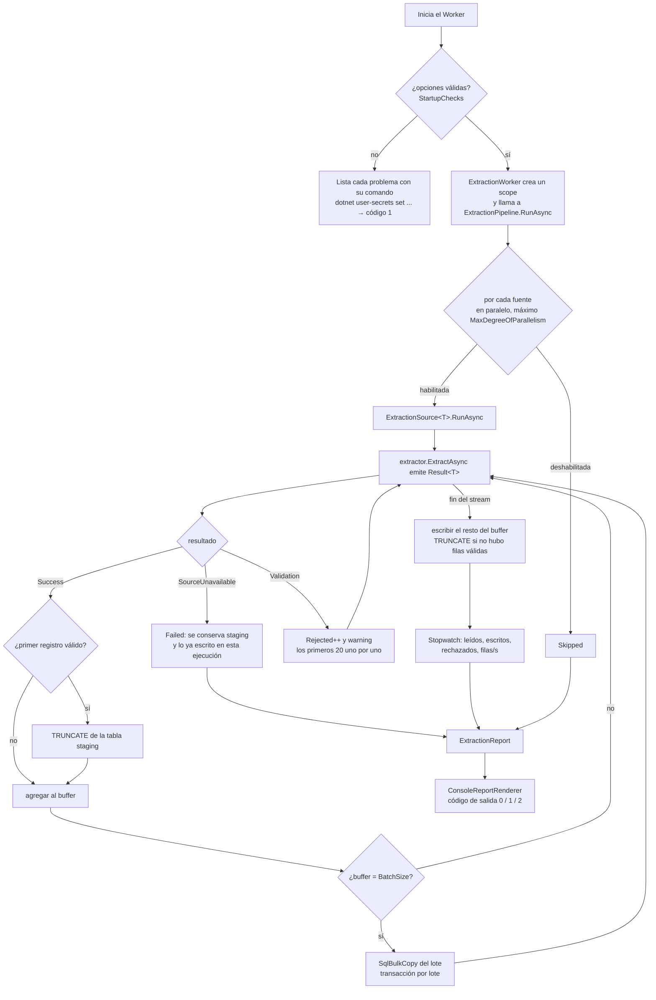

# Flujo de la extracción

## Flujo general



## Secuencia de la ejecución de una fuente

Ejemplo con la fuente API; las fuentes CSV y de base de datos siguen el mismo esquema y solo cambia el `ExtractCoreAsync` de su clase base.

```mermaid
sequenceDiagram
    autonumber
    participant P as ExtractionPipeline
    participant S as ExtractionSource&lt;StagingSocialComment&gt;
    participant E as SocialCommentApiExtractor
    participant C as SocialCommentsApiClient
    participant API as Transactional.Api
    participant R as SqlBulkStagingRepository
    participant DW as OpinionesClientesDW

    P->>S: RunAsync(ct) (dentro del SemaphoreSlim)
    S->>E: ExtractAsync(ct)
    loop página 1..totalPages (máximo MaxPages)
        E->>C: GetPageAsync(page)
        C->>API: GET /api/v1/social-comments?pageNumber&pageSize<br/>X-Api-Key (reintentos y timeout estándar)
        API-->>C: 200 PagedResponse
        C-->>E: Result.Success(page)
        loop cada comentario
            E-->>S: Result.Success(registro + SourceName + ExtractedAt)
            alt primer registro válido
                S->>R: TruncateAsync()
                R->>DW: TRUNCATE TABLE [Staging].[SocialComments]
            end
            alt buffer lleno (BatchSize)
                S->>R: BulkInsertAsync(lote)
                R->>DW: SqlBulkCopy (TableLock, transacción)
            end
        end
    end
    S->>R: BulkInsertAsync(resto del buffer)
    R->>DW: SqlBulkCopy
    S-->>P: SourceExtractionResult (Succeeded / CompletedWithRejections / Failed)
```

## Errores por tipo de fuente

| Situación | Resultado |
|---|---|
| Archivo inexistente o sin una columna obligatoria | `SourceUnavailable` → `Failed`, no se trunca staging |
| Fila con otra cantidad de columnas o mal formada | `Validation` → `Rejected`, la fuente continúa |
| Valor más largo que su columna staging | `Validation` → `Rejected` (antes de entrar al lote) |
| Base de datos de origen inaccesible | `SourceUnavailable` → `Failed` |
| API caída, 401 o 400 en la primera página | `SourceUnavailable` → `Failed` |
| Error en una página posterior | `Failed`; se conserva lo escrito de las páginas anteriores |
| `commentId` repetido entre páginas | `Validation` → `Rejected` |
| Data warehouse inaccesible al truncar o insertar | `Persistence` → `Failed` |
| Excepción inesperada dentro de una fuente | el pipeline la registra y marca solo esa fuente como `Failed` |
