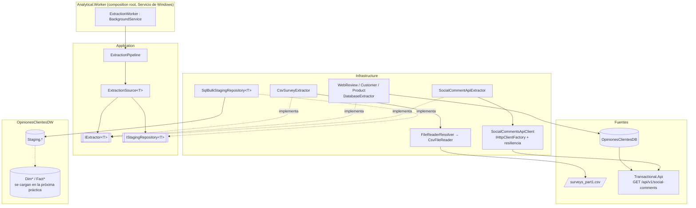
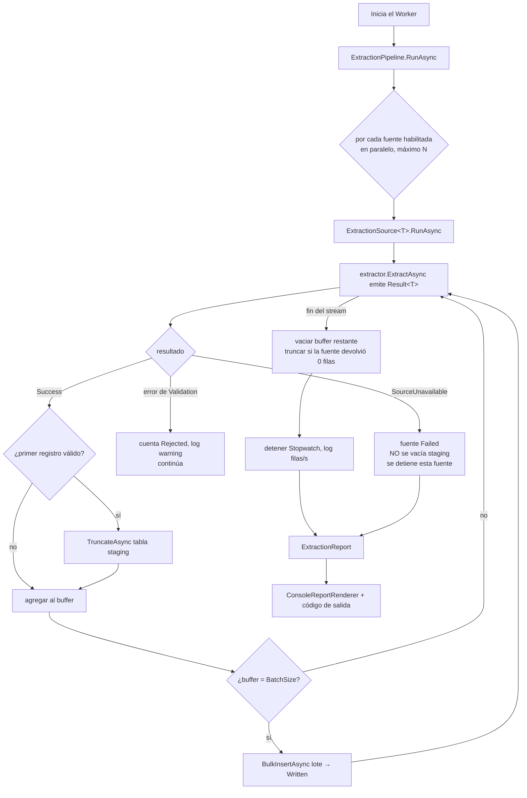

# Analytical — ETL hacia `OpinionesClientesDW`

Especificación técnica de la parte analítica de la solución. **Alcance actual: la fase de Extracción (la "E" del ETL).** La transformación y la carga al modelo estrella son una práctica posterior. Este documento marca dónde se conectarán, pero **no deben implementarse ahora**.

> Fuente de verdad para el agente de programación. Si algo es ambiguo, seguir este documento; si no dice nada, seguir `AGENTS.md`.
> El código va en inglés; este documento, en español.

---

## 1. Alcance

### 1.1 Dentro del alcance

| # | Entregable |
|---|---|
| 1 | Solución con Clean Architecture: Domain, Application, Infrastructure y Worker. |
| 2 | Tres componentes de extracción, uno por tipo de fuente: **CSV** (encuestas internas), **base de datos relacional** (reseñas web + datos maestros para las dimensiones) y **API REST** (comentarios sociales). |
| 3 | Datos extraídos guardados en **tablas staging** de `OpinionesClientesDW` (esquema `Staging`) con `SqlBulkCopy`. |
| 4 | Logs con `ILogger` (sinks de Serilog: consola + archivo rotativo) y métricas de rendimiento por fuente con `Stopwatch`. |
| 5 | Configuración centralizada y validada en `appsettings.json`; secretos fuera del repositorio (User Secrets / variables de entorno). |
| 6 | Worker instalable como Servicio de Windows (y ejecutable como proceso de consola). |
| 7 | SQL (**ya escrito, incluido en el repositorio**): `database/analytical/02_CreateStaging.sql` (esquema y tablas staging, §6.3), `database/transactional/04_ExtractionObjects.sql` (vistas de origen y procedimiento de la API, §6.2) y `database/analytical/03_LoadProcedures.sql` (procedimientos de carga adelantados, §6.5). |
| 8 | La API REST que publica los comentarios sociales (`src/Transactional/CustomersOpinions.Transactional.Api`, contrato en §6.4). Pertenece a la parte Transactional porque expone datos transaccionales; el ETL solo la consume. |
| 9 | Modelos de dominio de **todas** las dimensiones y hechos del data warehouse. El profesor los exige en esta entrega aunque se carguen después. |
| 10 | Generador de 50.000 encuestas para demostrar el requisito de rendimiento. |

### 1.2 Fuera del alcance (NO construir)

- **Transformación:** limpieza, normalización, clasificación de sentimiento y extracción de palabras clave.
- **Carga desde C#:** componentes que llamen a los procedimientos de carga de dimensiones y hechos. Los procedimientos, el TVP y los UDDT **ya existen** en `03_LoadProcedures.sql` (§6.5), pero se conectan con C# en la próxima práctica.
- **Modificar los scripts SQL** de `database/` o crear objetos de base de datos adicionales.
- **Cambios a la base existente:** a las tablas de `01_CreateDataWarehouse.sql` ni a los objetos transaccionales.
- **Releer los seis CSV.** El profesor fue explícito: del CSV **solo se leen las encuestas internas**. Clientes, productos y las demás opiniones vienen de la base transaccional, que ya se cargó en la práctica anterior.
- **Entity Framework** en cualquier parte de Analytical; la materia exige ADO.NET.
- **Aplicaciones de escritorio o con interfaz gráfica.**
- **Proyectos de pruebas.**

---

## 2. Trazabilidad de requisitos

Requisitos del profesor (PDF de la actividad y clases grabadas) y requisitos no funcionales del SRS, con dónde se cumple cada uno:

| Requisito | Origen | Cómo se cumple |
|---|---|---|
| Worker Service .NET 8 que realiza la extracción | Actividad §2, SRS §2.4 | `CustomersOpinions.Analytical.Worker` (`BackgroundService`). |
| CSV: leer encuestas internas con CsvHelper | Actividad §2 | `CsvSurveyExtractor` + `CsvFileReader<T>`. |
| Base de datos: consultar reseñas de la BD relacional | Actividad §2 | `WebReviewDatabaseExtractor` sobre `dbo.vw_ExtractWebReviews`. |
| API: consumir comentarios con HttpClient | Actividad §2 | `SocialCommentApiExtractor` con un cliente tipado de `IHttpClientFactory`. |
| Guardar lo extraído en tablas staging | Actividad §2, diagrama de flujo del proyecto | `SqlBulkStagingRepository<T>` → esquema `Staging`. |
| Logs de eventos y errores con `ILogger` | Actividad §2 | `ILogger<T>` en todo el código; sinks de Serilog en consola y archivo. |
| Medir rendimiento con `Stopwatch` | Sugerencias de la actividad | Por fuente y por ejecución; filas/segundo en el log y en el reporte. |
| `IExtractor` + `CsvExtractor`, `DatabaseExtractor`, `ApiExtractor` | Sugerencias de la actividad | Jerarquía de §5.2. |
| Extraer **solo** lo que necesita el data warehouse (no copy-paste) | Clases grabadas 1 y 3 | Tablas de linaje de §6. |
| El lector de archivos debe aceptar un formato nuevo (ej. Excel) sin afectar al CSV | Clase grabada 3 | Strategy `IFileReader<T>` + `FileReaderResolver` (§5.3). |
| Interfaz base → clase abstracta por componente → implementación | Clase grabada 3 | §5.2. |
| Patrón repositorio sin EF; consultas solo en la capa de datos | Clase grabada 2 | Infrastructure contiene todo el SQL; Application solo ve interfaces. |
| Clase de resultado con indicador de éxito y mensaje | Clase grabada 2 | `Domain/Common/Result.cs`. |
| App de consola/servicio, instalable como servicio de Windows/Linux | Clase grabada 3 | `AddWindowsService()`, modos de ejecución `Once` / `Interval`. |
| Documentar los patrones y principios de diseño de la capa de datos | Clase grabada 3 | §11 de este README (el agente lo mantiene al día). |
| **Rendimiento**: 50.000 comentarios en menos de 5 minutos | SRS §3.2 | Streaming + lotes con `SqlBulkCopy` + fuentes en paralelo; se demuestra con el archivo de 50k (§12). |
| **Escalabilidad**: agregar fuentes sin rediseñar | SRS §3.2 | Fuente nueva = extractor nuevo + mapa de staging + sección de configuración; el pipeline no cambia. |
| **Seguridad**: credenciales de API y BD protegidas | SRS §3.2 | User Secrets / variables de entorno, header de API key, HTTPS, rol de mínimo privilegio. |
| **Mantenibilidad**: capas y patrones | Actividad §1 | Clean Architecture + SOLID (§11). |

---

## 3. Arquitectura

### 3.1 Proyectos y regla de dependencias

```
CustomersOpinions.Analytical.Domain          (sin dependencias)
        ▲
CustomersOpinions.Analytical.Application     (→ Domain)
        ▲
CustomersOpinions.Analytical.Infrastructure  (→ Application, Domain)
        ▲
CustomersOpinions.Analytical.Worker          (→ Application, Infrastructure)  ← composition root
```

Las dependencias solo apuntan hacia adentro. Domain y Application nunca referencian SQL Server, CsvHelper, `HttpClient` ni Serilog.

| Proyecto | Tipo | Paquetes NuGet permitidos |
|---|---|---|
| Domain | Class library | ninguno |
| Application | Class library | `Microsoft.Extensions.Logging.Abstractions`, `Microsoft.Extensions.DependencyInjection.Abstractions` |
| Infrastructure | Class library | `CsvHelper`, `Microsoft.Data.SqlClient`, `Microsoft.Extensions.Http`, `Microsoft.Extensions.Http.Resilience`, `Microsoft.Extensions.Options.ConfigurationExtensions`, `Microsoft.Extensions.Options.DataAnnotations`, `Microsoft.Extensions.Logging.Abstractions` |
| Worker | Worker Service (`Microsoft.NET.Sdk.Worker`) | `Microsoft.Extensions.Hosting`, `Microsoft.Extensions.Hosting.WindowsServices`, `Serilog.Extensions.Hosting`, `Serilog.Settings.Configuration`, `Serilog.Sinks.Console`, `Serilog.Sinks.File` |

Usar las versiones más recientes compatibles con `net8.0`.

### 3.2 Diagrama de arquitectura



### 3.3 Estructura de carpetas

```
src/Analytical/
├── CustomersOpinions.Analytical.Domain/
│   ├── Common/
│   │   ├── Result.cs                    Result y Result<T> (IsSuccess, Message, ErrorType, Value)
│   │   └── ErrorType.cs                 None, Validation, SourceUnavailable, Persistence, Unexpected
│   ├── Staging/                         un registro por tabla staging (texto crudo + metadatos)
│   │   ├── StagingRecord.cs             base abstracta: SourceName, ExtractedAt, WithMetadata()
│   │   ├── StagingSurvey.cs
│   │   ├── StagingWebReview.cs
│   │   ├── StagingSocialComment.cs
│   │   ├── StagingCustomer.cs
│   │   └── StagingProduct.cs
│   └── DataWarehouse/
│       ├── Dimensions/
│       │   ├── DimTime.cs, DimProduct.cs, DimCustomer.cs, DimChannel.cs,
│       │   └── DimClassification.cs, DimEvent.cs, DimKeyword.cs
│       └── Facts/
│           ├── FactOpinion.cs
│           └── FactOpinionKeyword.cs
├── CustomersOpinions.Analytical.Application/
│   ├── Abstractions/
│   │   ├── Extraction/   IExtractor.cs (incluye el enum SourceKind), IExtractor{T}.cs, IExtractionSource.cs, IExtractionPipeline.cs
│   │   ├── Reading/      IFileReader{TRow}.cs, IFileReaderResolver.cs
│   │   └── Persistence/  IStagingRepository{T}.cs
│   ├── Extraction/       ExtractionPipeline.cs, ExtractionSource{T}.cs, ExtractionSettings.cs, SourceSettings.cs
│   ├── Reporting/        ExtractionReport.cs, SourceExtractionResult.cs, SourceStatus.cs
│   └── DependencyInjection.cs           AddApplication()
├── CustomersOpinions.Analytical.Infrastructure/
│   ├── Configuration/    ConnectionStringsOptions.cs, ExtractionOptions.cs, SurveysSourceOptions.cs,
│   │                     DatabaseSourceOptions.cs (opciones con nombre: WebReviews, Customers, Products),
│   │                     SocialCommentsSourceOptions.cs, SecretHints.cs (mensajes con el comando user-secrets)
│   ├── Extraction/
│   │   ├── Base/         ExtractorBase.cs, FileExtractorBase.cs, DatabaseExtractorBase.cs, ApiExtractorBase.cs
│   │   ├── Csv/          CsvSurveyExtractor.cs
│   │   ├── Database/     WebReviewDatabaseExtractor.cs, CustomerDatabaseExtractor.cs,
│   │   │                 ProductDatabaseExtractor.cs, ExtractionQueries.cs
│   │   └── Api/          SocialCommentApiExtractor.cs
│   ├── Sources/                         modelos con la forma de cada origen, agrupados por origen (pedido del profesor)
│   │   ├── Csv/          SurveyFileRow.cs, SurveyFileRowMap.cs
│   │   ├── Database/     WebReviewRow.cs, CustomerRow.cs, ProductRow.cs, DbValue.cs (valores tipados → texto invariante)
│   │   └── Api/          SocialCommentDto.cs, PagedResponse.cs, SocialCommentsApiClient.cs
│   ├── Reading/          CsvFileReader.cs, FileReaderResolver.cs
│   ├── Persistence/      IDbConnectionFactory.cs (incluye ConnectionNames), SqlConnectionFactory.cs, SqlBulkStagingRepository.cs,
│   │                     StagingTableMap.cs, StagingTableMaps.cs
│   └── DependencyInjection.cs           AddInfrastructure(IConfiguration)
└── CustomersOpinions.Analytical.Worker/
    ├── Program.cs
    ├── ExtractionWorker.cs
    ├── WorkerOptions.cs                 RunMode (Once | Interval), IntervalMinutes
    ├── StartupChecks.cs                 valida las opciones antes de iniciar y muestra mensajes legibles
    ├── Presentation/ConsoleReportRenderer.cs
    ├── appsettings.json
    ├── appsettings.Development.json
    └── Properties/launchSettings.json
```

El profesor pidió los modelos agrupados por origen (`Api/`, `Csv/`, `Database/`), además de `DataWarehouse/Dimensions` y `DataWarehouse/Facts`. En Clean Architecture eso se traduce así:
- `Infrastructure/Sources/{Csv,Database,Api}`: los modelos con la forma del origen son un detalle de infraestructura.
- `Domain/DataWarehouse/{Dimensions,Facts}`: el modelo de negocio.

Esta correspondencia se explica en §11.

---

## 4. Domain

### 4.1 Result

```csharp
public enum ErrorType { None, Validation, SourceUnavailable, Persistence, Unexpected }

public class Result
{
    public bool IsSuccess { get; }
    public string Message { get; }        // pedido por el profesor: indicador de éxito + mensaje
    public ErrorType ErrorType { get; }
    public bool IsFailure => !IsSuccess;
    public static Result Success(string message = "") ...
    public static Result Failure(ErrorType type, string message) ...
}

public sealed class Result<T> : Result
{
    public T? Value { get; }
    public static Result<T> Success(T value, string message = "") ...
    public static new Result<T> Failure(ErrorType type, string message) ...
}
```

Nada de excepciones para fallos esperados (fila mala, fuente inaccesible). Las excepciones quedan solo para errores de programación y cancelación.

### 4.2 Registros de staging

Tipos `sealed record` inmutables. **Todos los campos de negocio son `string?` con el valor crudo tal como se extrajo**; la fase T los convierte. Cada registro lleva además:

- `SourceName` (`string`): nombre del archivo, de la vista o del endpoint. Se escribe en la columna de metadatos de su tabla.
- `ExtractedAt` (`DateTime`, UTC): un valor por ejecución de la fuente.

| Registro | Campos |
|---|---|
| `StagingSurvey` | `SurveyId`, `CustomerId`, `ProductId`, `SurveyDate`, `Comment`, `Classification`, `SatisfactionScore`, `Source` |
| `StagingWebReview` | `ReviewId`, `CustomerId`, `ProductId`, `ReviewDate`, `Comment`, `Rating` |
| `StagingSocialComment` | `CommentId`, `CustomerId` (null = anónimo), `ProductId`, `Platform`, `CommentDate`, `Comment` |
| `StagingCustomer` | `CustomerId`, `Name`, `Email`, `IsInferred` |
| `StagingProduct` | `ProductId`, `Name`, `Category`, `IsInferred` |

Los valores que vienen de columnas tipadas de la base se convierten con `CultureInfo.InvariantCulture`: fechas como `yyyy-MM-dd` y booleanos como `"1"`/`"0"`.

### 4.3 Modelos del data warehouse

Clases simples que reflejan `database/analytical/01_CreateDataWarehouse.sql`. Los nombres de las propiedades van en inglés; los nombres de tablas y columnas de la base están en español y **no deben renombrarse**. Cada clase lleva un `<summary>` XML con el nombre de su tabla, y cada propiedad con el de su columna, para que la fase de carga pueda mapearlas.

| Clase → tabla | Propiedades → columnas |
|---|---|
| `DimTime` → `DimTiempo` | `TimeKey`→TiempoKey (int, yyyyMMdd), `Date`→Fecha, `Year`→Anio, `Semester`→Semestre, `Quarter`→Trimestre, `Month`→Mes, `MonthName`→NombreMes, `YearMonth`→AnioMes, `WeekOfYear`→SemanaAnio, `Day`→Dia, `DayOfWeek`→DiaSemana, `DayName`→NombreDia, `IsWeekend`→EsFinDeSemana |
| `DimProduct` → `DimProducto` | `ProductKey`, `SourceProductId`→IdProductoOrigen, `Name`, `Category`, `IsInferred`→EsInferido |
| `DimCustomer` → `DimCliente` | `CustomerKey`, `SourceCustomerId` (int?, null = miembro anónimo)→IdClienteOrigen, `Name`, `Email`, `Country`→Pais, `AgeRange`→RangoEdad, `CustomerType`→TipoCliente, `IsInferred` |
| `DimChannel` → `DimCanal` | `ChannelKey`, `Channel`→Canal, `Platform`→Plataforma, `SourceType`→TipoOrigen |
| `DimClassification` → `DimClasificacion` | `ClassificationKey`, `Name`→Nombre, `SentimentValue` (short?)→ValorSentimiento |
| `DimEvent` → `DimEvento` | `EventKey`, `Name`, `EventType`→TipoEvento, `StartDate`→FechaInicio, `EndDate`→FechaFin |
| `DimKeyword` → `DimPalabraClave` | `KeywordKey`→PalabraKey, `Word`→Palabra |
| `FactOpinion` → `FactOpinion` | `OpinionKey` (long), `TimeKey`, `ProductKey`, `CustomerKey`, `ChannelKey`, `ClassificationKey`, `EventKey`, `SourceOpinionId`→IdOpinionOrigen, `Comment`→Comentario, `Quantity`→Cantidad, `Score` (byte?)→Puntaje, `IsSatisfied` (bool?, columna calculada, solo lectura)→EsSatisfecho, `LoadedAt`→FechaCarga |
| `FactOpinionKeyword` → `FactOpinionPalabra` | `OpinionKey`, `KeywordKey`→PalabraKey, `Frequency`→Frecuencia |

El código de extracción **todavía no usa** estas clases.

---

## 5. Application y componentes de extracción

### 5.1 Comportamiento del pipeline



Reglas:

1. **Refresco completo por fuente.** Cada ejecución reemplaza el contenido de su tabla staging. La tabla se trunca solo cuando llega el primer registro válido; así, una fuente inaccesible **conserva los datos de la ejecución anterior**.
2. **Aislamiento.** Una fuente que falla nunca detiene a las demás:
   - una excepción inesperada dentro de una fuente la captura el pipeline, que la registra en el log con la excepción y la reporta como `Failed`;
   - `OperationCanceledException` se relanza.
3. **Un registro malo nunca detiene una fuente.** Se cuenta como `Rejected` y se registra en el log: los primeros 20 de cada fuente uno por uno, y luego una línea de resumen.
4. **Streaming.** Los extractores devuelven `IAsyncEnumerable<Result<T>>`; nada carga una fuente completa en memoria. El consumo de memoria lo acota `BatchSize`.
5. **Paralelismo.** `Task.WhenAll` sobre las fuentes habilitadas, limitado con `SemaphoreSlim(Extraction:MaxDegreeOfParallelism)`.
6. **Métricas.** Un `Stopwatch` por fuente y otro para la ejecución completa. Se registran leídos, escritos, rechazados, tiempo y filas por segundo.
7. **Cancelación.** El `CancellationToken` se pasa a cada llamada asíncrona.

### 5.2 Jerarquía de extractores (interfaz base → clase abstracta → implementación)

```
IExtractor                                    Application   Name, SourceKind (File | Database | Api)
└── IExtractor<TRecord>                       Application   IAsyncEnumerable<Result<TRecord>> ExtractAsync(CancellationToken)
    └── ExtractorBase<TRecord>                Infrastructure  Template Method: tiempo, logs, excepción → SourceUnavailable
        ├── FileExtractorBase<TRow, TRecord>  resuelve un IFileReader<TRow> por extensión; Map(TRow) → TRecord abstracto
        │   └── CsvSurveyExtractor            (conserva el nombre que pide la actividad para el componente CSV)
        ├── DatabaseExtractorBase<TRecord>    abre DbConnection, ejecuta una consulta con CommandBehavior.SequentialAccess,
        │   │                                 emite las filas del DbDataReader; Query y Map(DbDataReader) abstractos
        │   ├── WebReviewDatabaseExtractor
        │   ├── CustomerDatabaseExtractor
        │   └── ProductDatabaseExtractor
        └── ApiExtractorBase<TDto, TRecord>   recorre las páginas de un endpoint hasta que no haya más; GetPageAsync y Map abstractos
            └── SocialCommentApiExtractor
```

`ExtractorBase<TRecord>` implementa `ExtractAsync` como una plantilla sellada que llama al método protegido abstracto `ExtractCoreAsync`. Además:
- registra en el log el inicio y el fin, las filas emitidas, el tiempo y las filas por segundo;
- convierte las excepciones de infraestructura que ocurran antes del primer registro (`SqlException`, `HttpRequestException`, `IOException`, timeouts) en un único `Result.Failure(SourceUnavailable, mensaje)`;
- agrega `SourceName` y `ExtractedAt` (de un `TimeProvider` inyectado) a cada registro.

### 5.3 Estrategia de lectura de archivos (extensible a Excel)

```csharp
public interface IFileReader<TRow>
{
    IReadOnlyCollection<string> SupportedExtensions { get; }   // ej. ".csv"
    IAsyncEnumerable<Result<TRow>> ReadAsync(string path, CancellationToken ct);
}

public interface IFileReaderResolver
{
    Result<IFileReader<TRow>> Resolve<TRow>(string path);       // por extensión; Failure si no se soporta
}
```

> Implementado: `Resolve` devuelve `Result<IFileReader<TRow>>` para poder expresar el "Failure si no se soporta" sin excepciones.

- **`CsvFileReader<TRow>`:** usa CsvHelper con `CultureInfo.InvariantCulture`, UTF-8 con detección de BOM, `TrimOptions.Trim`, un `ClassMap<TRow>` registrado y un buffer de lectura de 64 KB.
- **Validación de encabezados:**
  - si falta una columna → `SourceUnavailable` (error de estructura; no se trunca nada);
  - si una fila tiene otra cantidad de columnas o un error de parseo → falla de `Validation` solo para esa fila.
- **`SurveyFileRowMap`:** mapea los encabezados en español del archivo: `IdOpinion, IdCliente, IdProducto, Fecha, Comentario, Clasificación, PuntajeSatisfacción, Fuente`.
- **Agregar Excel más adelante** consiste en crear `ExcelFileReader<TRow>` y registrarlo en la inyección de dependencias. `CsvSurveyExtractor`, el pipeline y el lector CSV no cambian. Documentarlo en §11, pero no implementar Excel ahora.

### 5.4 Repositorio de staging

```csharp
public interface IStagingRepository<T>
{
    string TableName { get; }
    Task<Result> TruncateAsync(CancellationToken ct);
    Task<Result<int>> BulkInsertAsync(IReadOnlyCollection<T> batch, CancellationToken ct);
}
```

`SqlBulkStagingRepository<T>` es una sola clase genérica, configurada con un `StagingTableMap<T>`:
- **`StagingTableMap<T>`:** esquema, tabla, nombres de columnas en orden y un selector de valores `Func<T, object?[]>`. Todos los mapas viven en `StagingTableMaps.cs`.
- **Escritura:** arma un `DataTable` por lote (o un `IDataReader` sobre el lote) y lo escribe con `SqlBulkCopy`, dentro de una transacción por lote. Opciones: `SqlBulkCopyOptions.TableLock`, mapeo explícito de columnas y `BulkCopyTimeout` de 300 s.
- **`TruncateAsync`:** ejecuta `TRUNCATE TABLE [Staging].[X]`. El nombre de la tabla sale solo del mapa (nunca de la configuración ni de la entrada) y se valida contra el conjunto de tablas conocidas.
- **Errores:** una `SqlException` se convierte en `Result.Failure(Persistence, ...)` y la fuente queda marcada como `Failed`.
- **Conexiones:** salen de `IDbConnectionFactory`, que devuelve un `DbConnection`; `SqlConnectionFactory` es la implementación para SQL Server.

### 5.5 Reporte

- **`SourceExtractionResult`:** `SourceName`, `TableName`, `Status` (`Succeeded`, `CompletedWithRejections`, `Failed`, `Skipped`), `Read`, `Written`, `Rejected`, `Elapsed`, `RowsPerSecond`, `Message`.
- **`ExtractionReport`:** la lista de resultados, los totales, el tiempo total y `AnyFailed`.

`ConsoleReportRenderer` (en el Worker) imprime una tabla como esta:

```
CustomersOpinions — Extraction run 2026-11-21 10:15:02
Source            Staging table              Status     Read    Written  Rejected  Elapsed   Rows/s
Surveys (CSV)     Staging.Surveys            OK          500       500        0  00:00.21    2,380
WebReviews (DB)   Staging.WebReviews         OK          200       200        0  00:00.09    2,222
Customers (DB)    Staging.Customers          OK          965       965        0  00:00.11    8,772
Products (DB)     Staging.Products           OK          502       502        0  00:00.08    6,275
SocialComments    Staging.SocialComments     FAILED        0         0        0  00:03.01        0   API unreachable
TOTAL                                                   2,167     2,167        0  00:03.05
```

---

## 6. Contratos de datos

### 6.1 Qué se extrae y por qué (linaje de datos)

Solo se extraen los campos que necesita el data warehouse.

| Destino en el DW | Encuesta (CSV) | Reseña web (BD) | Comentario social (API) |
|---|---|---|---|
| `FactOpinion.IdOpinionOrigen` | `IdOpinion` | `IdReview` | `IdComment` |
| `TiempoKey` (→ `DimTiempo`) | `Fecha` | `Fecha` | `Fecha` |
| `ProductoKey` (→ `DimProducto`) | `IdProducto` | `IdProducto` | `IdProducto` |
| `ClienteKey` (→ `DimCliente`) | `IdCliente` | `IdCliente` | `IdCliente` (null → miembro anónimo) |
| `CanalKey` (→ `DimCanal`) | canal constante "Encuesta Interna"; plataforma desde `Fuente`; tipo de origen CSV | constante "Web"; tipo de origen Base de datos | "Red Social"; plataforma = `RedSocial`; tipo de origen API |
| `ClasificacionKey` | `Clasificación` | se deriva en Transformación (clasificador por palabras clave) | se deriva en Transformación |
| `Puntaje` | `PuntajeSatisfacción` | `Rating` | null |
| `Comentario` + palabras clave (`FactOpinionPalabra`) | `Comentario` | `Comentario` | `Comentario` |
| `EventoKey` | se deriva en Transformación comparando la fecha con los rangos de `DimEvento` (por defecto "Ninguno") | igual | igual |

| Destino en el DW | Origen (BD) | Campos |
|---|---|---|
| `DimCliente` | `dbo.vw_ExtractCustomers` | `IdCliente`, `Nombre`, `Email`, `EsInferido`. `Pais`, `RangoEdad` y `TipoCliente` **no tienen fuente** y quedarán en "Desconocido" (valor por defecto) en la fase de carga. |
| `DimProducto` | `dbo.vw_ExtractProducts` | `IdProducto`, `Nombre`, `Categoria` (de `dbo.Categoria`), `EsInferido` |

**No se extrae, a propósito:**
- `IdFuente` e `IdClasificacion` de reseñas y comentarios (siempre son NULL en el origen);
- las columnas `FechaRegistro`;
- `FuenteDatos`, `Venta` y `DetalleVenta`;
- `dbo.Encuesta`: las encuestas salen del CSV, como pidió el profesor.

**Dimensiones sin extracción:** `DimTiempo`, `DimCanal`, `DimClasificacion` y `DimEvento` se generan o se precargan en la fase de carga.

### 6.2 Objetos de origen — `database/transactional/04_ExtractionObjects.sql`

Script **ya incluido** en el repositorio, idempotente (`create or alter`), sobre `OpinionesClientesDB`. Resumen de su contenido (el script es la referencia exacta):

```sql
-- Reseñas para el extractor de base de datos
create or alter view dbo.vw_ExtractWebReviews as
select w.IdReview, w.IdCliente, w.IdProducto, w.Fecha, w.Comentario, w.Rating
from dbo.ResenaWeb w;

-- Datos maestros para DimCliente
create or alter view dbo.vw_ExtractCustomers as
select c.IdCliente, c.Nombre, c.Email, c.EsInferido
from dbo.Cliente c;

-- Datos maestros para DimProducto (categoría desnormalizada, como en el modelo estrella)
create or alter view dbo.vw_ExtractProducts as
select p.IdProducto, p.Nombre, cat.Nombre as Categoria, p.EsInferido
from dbo.Producto p
join dbo.Categoria cat on cat.IdCategoria = p.IdCategoria;

-- Comentarios sociales paginados para la API REST
create or alter procedure dbo.usp_GetSocialCommentsPage
    @PageNumber int,
    @PageSize   int,
    @TotalCount int output
as
begin
    set nocount on;
    select @TotalCount = count(*) from dbo.ComentarioSocial;
    select s.IdComment, s.IdCliente, s.IdProducto, r.Nombre as RedSocial, s.Fecha, s.Comentario
    from dbo.ComentarioSocial s
    join dbo.RedSocial r on r.IdRedSocial = s.IdRedSocial
    order by s.IdComment
    offset (@PageNumber - 1) * @PageSize rows fetch next @PageSize rows only;
end
```

Las consultas del extractor de base de datos viven en `ExtractionQueries.cs` y leen **solo** estas vistas. Usan `CommandType.Text`, lista explícita de columnas y `ORDER BY` por el id de origen.

El script incluye además una sección opcional comentada que crea un rol de mínimo privilegio (`etl_reader`: `SELECT` sobre las tres vistas y `EXECUTE` sobre el procedimiento), para la documentación de seguridad.

### 6.3 Tablas staging — `database/analytical/02_CreateStaging.sql`

Script **ya incluido** en el repositorio, idempotente, sobre `OpinionesClientesDW`: crea el esquema y cada tabla solo si no existen. Resumen de su contenido (el script es la referencia exacta):

Son tablas heap, sin llaves ni restricciones:
- staging debe aceptar los datos crudos tal como llegan; la validación y la deduplicación son de la fase de Transformación;
- los heaps aprovechan al máximo la inserción masiva con `TABLOCK`.

La intercalación se hereda de la base (`Modern_Spanish_CI_AS`).

```sql
create schema Staging;

create table Staging.Surveys (
    SurveyId          varchar(50)  null,
    CustomerId        varchar(50)  null,
    ProductId         varchar(50)  null,
    SurveyDate        varchar(50)  null,
    Comment           varchar(max) null,
    Classification    varchar(50)  null,
    SatisfactionScore varchar(20)  null,
    Source            varchar(100) null,
    SourceFile        varchar(260) not null,   -- metadato: nombre del archivo
    ExtractedAt       datetime2(0) not null    -- metadato: UTC
);

create table Staging.WebReviews (
    ReviewId     varchar(50)  null,
    CustomerId   varchar(50)  null,
    ProductId    varchar(50)  null,
    ReviewDate   varchar(50)  null,
    Comment      varchar(max) null,
    Rating       varchar(20)  null,
    SourceObject varchar(128) not null,        -- metadato: nombre de la vista
    ExtractedAt  datetime2(0) not null
);

create table Staging.SocialComments (
    CommentId      varchar(50)  null,
    CustomerId     varchar(50)  null,          -- null = comentario anónimo
    ProductId      varchar(50)  null,
    Platform       varchar(50)  null,
    CommentDate    varchar(50)  null,
    Comment        varchar(max) null,
    SourceEndpoint varchar(500) not null,      -- metadato: URL del endpoint (sin credenciales)
    ExtractedAt    datetime2(0) not null
);

create table Staging.Customers (
    CustomerId   varchar(50)  null,
    Name         varchar(200) null,
    Email        varchar(200) null,
    IsInferred   varchar(5)   null,
    SourceObject varchar(128) not null,
    ExtractedAt  datetime2(0) not null
);

create table Staging.Products (
    ProductId    varchar(50)  null,
    Name         varchar(200) null,
    Category     varchar(100) null,
    IsInferred   varchar(5)   null,
    SourceObject varchar(128) not null,
    ExtractedAt  datetime2(0) not null
);
```

Un valor más largo que su columna se rechaza como `Validation` en el extractor, antes de entrar al buffer. Así, un solo valor largo nunca hace fallar un lote completo de inserción masiva.

### 6.4 Contrato de la API REST (implementada en `src/Transactional/CustomersOpinions.Transactional.Api`)

`GET /api/v1/social-comments?pageNumber=1&pageSize=500` — header `X-Api-Key: <clave>`

```json
{
  "pageNumber": 1,
  "pageSize": 500,
  "totalCount": 200,
  "totalPages": 1,
  "items": [
    {
      "commentId": "T0001",
      "customerId": 19,
      "productId": 3,
      "platform": "Instagram",
      "commentDate": "2025-06-15",
      "comment": "Información suficiente, sin mayor novedad"
    }
  ]
}
```

| Estado | Cuándo |
|---|---|
| 200 | Página devuelta. Una página fuera de rango devuelve `items` vacío. |
| 400 | `pageNumber < 1` o `pageSize < 1`. Un `pageSize` mayor que `Paging:MaxPageSize` se ajusta al máximo. |
| 401 | Falta `X-Api-Key` o es incorrecta. Se compara con `CryptographicOperations.FixedTimeEquals`. |
| 503 | La base de datos no está disponible. |

`GET /health` (sin clave) → `200 {"status":"Healthy"}` o `503`. Swagger solo en Development.

**Comportamiento de `SocialCommentApiExtractor`:**
- **Paginación:** lee páginas desde la 1 hasta que `pageNumber > totalPages` o llegue una página vacía. `MaxPages` funciona como límite de seguridad.
- **Duplicados:** detecta un `commentId` repetido entre páginas y lo cuenta como rechazado.
- **Errores:**
  - un 401, un 400 u otra respuesta no exitosa en la primera página → `SourceUnavailable`;
  - en una página posterior → la fuente queda `Failed` y se conserva lo ya escrito. Esta decisión se documenta.
- **Clientes anónimos:** un `customerId` null es válido.

### 6.5 Procedimientos de carga adelantados — `database/analytical/03_LoadProcedures.sql`

El profesor pidió ir creando en esta práctica los procedimientos almacenados que usará la carga al DW, para hacerla con ADO.NET y no con Entity Framework. El script ya está incluido; **el código C# de esta práctica no los llama**. Contenido:

| Objeto | Tipo | Propósito |
|---|---|---|
| `dbo.udtIdOrigen`, `dbo.udtComentario`, `dbo.udtNombre` | UDDT | Definición única de campos repetidos (DRY en la base). |
| `dbo.fn_GetDateKey(@Fecha)` | Función escalar | Clave entera `yyyyMMdd` de `DimTiempo`, reutilizable. |
| `dbo.usp_LoadDimTiempo` | Procedimiento | Genera las fechas faltantes de un rango. |
| `dbo.usp_LoadDimCliente`, `dbo.usp_LoadDimProducto` | Procedimiento | Insertan si no existe y actualizan solo si cambió (SCD tipo 1), con `IF EXISTS`. Devuelven `Insertado` / `Actualizado` / `SinCambios`. |
| `dbo.usp_LoadDimCanal`, `dbo.usp_LoadDimEvento`, `dbo.usp_LoadDimPalabraClave` | Procedimiento | Altas de canales, eventos y palabras. |
| `dbo.usp_SeedDimensionMembers` | Procedimiento | Miembros por defecto: clasificaciones (incluida "Sin clasificar"), los 5 canales, evento "Ninguno" y cliente "Anónimo". |
| `dbo.FactOpinionTableType` + `dbo.usp_LoadFactOpinion` | TVP + procedimiento | Carga de opiniones en un solo viaje. Resuelve las llaves con joins y descarta duplicados con `NOT EXISTS`. Devuelve insertados y omitidos. |
| `Staging.OpinionKeywords` + `dbo.usp_LoadFactOpinionPalabra` | Tabla + procedimiento | Vía **bulk insert**: el ETL escribe las palabras con `SqlBulkCopy` y el procedimiento crea las palabras nuevas y la relación opinión-palabra. |

Así la práctica usa las dos técnicas de carga masiva que pidió el profesor: **TVP** para `FactOpinion` y **bulk insert** para `FactOpinionPalabra`.

---

## 7. Worker

- **`Program.cs`:**
  - `Host.CreateApplicationBuilder(args)`;
  - orden de la configuración: `appsettings.json` → `appsettings.{Environment}.json` → User Secrets (Development) → variables de entorno → línea de comandos;
  - `builder.Services.AddWindowsService(o => o.ServiceName = "CustomersOpinions Extraction")`;
  - Serilog desde la configuración, con salida a consola y a `logs/extraction-.log` (un archivo por día, se conservan 30);
  - `AddApplication()`, `AddInfrastructure(builder.Configuration)` y `AddHostedService<ExtractionWorker>()`.
- **Opciones:** se enlazan con `AddOptions<T>().Bind(...).ValidateDataAnnotations().ValidateOnStart()`. Si falta una cadena de conexión o la API key, el Worker falla al iniciar con un mensaje que muestra el comando exacto `dotnet user-secrets set ...`, sin imprimir nunca el valor de los secretos.
- **`ExtractionWorker : BackgroundService`:**
  - `RunMode = Once` (por defecto): ejecuta el pipeline una vez, muestra el reporte, fija `Environment.ExitCode` (0 = todas las fuentes OK, 1 = alguna falló, 2 = cancelado) y llama a `IHostApplicationLifetime.StopApplication()`.
  - `RunMode = Interval`: ciclo con `PeriodicTimer(IntervalMinutes)`. Es el modo que se usa al instalarlo como Servicio de Windows.
- **Archivo de encuestas:** `data/csv/surveys_part1.csv` se copia a la carpeta de salida como `Data/surveys_part1.csv`, mediante un elemento vinculado en el `.csproj`.

---

## 8. Configuración — `appsettings.json` (versionado, sin secretos)

```json
{
  "ConnectionStrings": {
    "TransactionalDb": "",
    "AnalyticalDb": ""
  },
  "Worker": {
    "RunMode": "Once",
    "IntervalMinutes": 60
  },
  "Extraction": {
    "BatchSize": 5000,
    "MaxDegreeOfParallelism": 5
  },
  "Sources": {
    "Surveys": {
      "Enabled": true,
      "FilePath": "Data/surveys_part1.csv"
    },
    "WebReviews": { "Enabled": true, "CommandTimeoutSeconds": 120 },
    "Customers":  { "Enabled": true, "CommandTimeoutSeconds": 120 },
    "Products":   { "Enabled": true, "CommandTimeoutSeconds": 120 },
    "SocialComments": {
      "Enabled": true,
      "BaseUrl": "https://localhost:7181",
      "Endpoint": "/api/v1/social-comments",
      "PageSize": 500,
      "MaxPages": 10000,
      "TimeoutSeconds": 30,
      "RetryCount": 3,
      "ApiKey": ""
    }
  },
  "Serilog": {
    "MinimumLevel": {
      "Default": "Information",
      "Override": { "Microsoft": "Warning", "System": "Warning" }
    }
  }
}
```

- En el código, `Serilog:MinimumLevel:Override` incluye además `"Polly": "Fatal"`: los reintentos del handler de resiliencia no llenan la consola de stack traces; el fallo de la fuente igual se registra con su motivo.
- Las rutas relativas de `FilePath` se resuelven contra `AppContext.BaseDirectory`.
- **Validaciones:**
  - `BatchSize` entre 1 y 100.000;
  - `MaxDegreeOfParallelism` entre 1 y 16;
  - `PageSize` entre 1 y 1.000;
  - `BaseUrl` debe ser una URL HTTPS absoluta cuando la fuente está habilitada;
  - los timeouts deben ser mayores que 0;
  - `RetryCount` entre 1 y 10 (mínimo que exige el handler de resiliencia estándar);
  - `Sources:SocialComments:ApiKey` y `BaseUrl` solo se validan cuando la fuente está habilitada;
  - si algo falla, el Worker no arranca y lista cada problema con el comando `dotnet user-secrets set ...` que lo corrige (`StartupChecks.cs`), sin stack trace y con código de salida 1.
- **Desactivar una fuente** es solo un cambio de configuración (`Enabled: false`). Sirve como evidencia del requisito de escalabilidad.

---

## 9. Seguridad

| Secreto | Dónde vive | Cómo configurarlo (desarrollo) |
|---|---|---|
| `ConnectionStrings:TransactionalDb` | User Secrets del Worker y de la Api | `dotnet user-secrets set "ConnectionStrings:TransactionalDb" "Server=.;Database=OpinionesClientesDB;Integrated Security=True;TrustServerCertificate=True" --project src/Analytical/CustomersOpinions.Analytical.Worker` |
| `ConnectionStrings:AnalyticalDb` | User Secrets del Worker | mismo formato con `Database=OpinionesClientesDW` |
| `Sources:SocialComments:ApiKey` | User Secrets del Worker | `dotnet user-secrets set "Sources:SocialComments:ApiKey" "<clave>" --project ...Worker` |
| `Security:ApiKey` | User Secrets de la Api | el mismo valor de clave, con `--project src/Transactional/CustomersOpinions.Transactional.Api` |

La clave se genera, no se inventa: `[Convert]::ToBase64String((1..32 | ForEach-Object { Get-Random -Maximum 256 }))`.

En un servidor (Servicio de Windows) se usan variables de entorno: `ConnectionStrings__AnalyticalDb`, `Sources__SocialComments__ApiKey`, etc.

Otras medidas:
- solo HTTPS entre el Worker y la API;
- la API key se compara en tiempo constante;
- los secretos nunca se escriben en el log: se registra la ruta del endpoint, no los headers ni las cadenas de conexión;
- SQL siempre parametrizado, y los nombres de las tablas staging nunca vienen de la entrada;
- rol opcional de mínimo privilegio en la base (§6.2);
- `appsettings.json` se versiona con valores vacíos para que documente la estructura esperada.

---

## 10. Resiliencia de la fuente API

El cliente tipado `SocialCommentsApiClient` se registra con `AddHttpClient<>`, es decir, con `IHttpClientFactory` y no con `new HttpClient()`. Configuración:
- `BaseAddress` y el header `X-Api-Key`, ambos tomados de las opciones;
- `AddStandardResilienceHandler()` (`Microsoft.Extensions.Http.Resilience`), con `RetryCount` reintentos y backoff exponencial ante errores transitorios (5xx, 408, 429), y `TimeoutSeconds` como timeout total.

---

## 11. Patrones y principios de diseño (capa de datos)

El profesor va a preguntar qué patrones y principios se aplicaron en la capa de datos. El agente debe mantener esta tabla alineada con el código final:

| Patrón / principio | Dónde | Por qué |
|---|---|---|
| Clean Architecture (regla de dependencias) | Referencias entre proyectos | Las reglas de negocio no dependen de SQL Server, CsvHelper ni HTTP. |
| Inversión de dependencias (SOLID-D) | `IExtractor<T>`, `IStagingRepository<T>`, `IFileReader<T>` en Application | El pipeline depende de abstracciones; las implementaciones son intercambiables. |
| Responsabilidad única (SOLID-S) | Un extractor por fuente; el repositorio solo escribe; el pipeline solo orquesta | Cada clase tiene un solo motivo de cambio. |
| Abierto/cerrado (SOLID-O) | Fuente nueva = extractor + mapa + configuración | No se modifican el pipeline ni los extractores existentes. |
| Sustitución de Liskov (SOLID-L) | `ExtractionSource<T>` ejecuta igual cualquier `IExtractor<T>` | Los extractores son intercambiables. |
| Segregación de interfaces (SOLID-I) | Interfaces pequeñas (`IFileReader`, `IStagingRepository`, `IExtractionSource`) | Cada consumidor ve solo lo que usa. |
| Repository | `SqlBulkStagingRepository<T>` | Abstrae la persistencia; no está atado a EF. |
| Template Method | `ExtractorBase<T>` y sus tres bases intermedias | Tiempo, logs y manejo de errores comunes se escriben una sola vez. |
| Strategy + Factory | `IFileReader<T>` + `FileReaderResolver`; `IDbConnectionFactory` | El formato se elige por extensión (CSV hoy, Excel después); la creación de conexiones se centraliza sobre `DbConnection`. |
| Options pattern | `IOptions<T>` + validación al iniciar | Configuración centralizada y validada. |
| Cliente tipado + resiliencia | `IHttpClientFactory`, handler de resiliencia estándar | Reutilización de sockets, reintentos y timeouts. |
| Result pattern | `Result` / `Result<T>` | Fallos esperados sin excepciones; indicador de éxito + mensaje. |
| Streaming / back-pressure | `IAsyncEnumerable<T>` + lotes acotados | Memoria constante; permite cumplir 50k en menos de 5 minutos. |
| Composition Root | `Worker/Program.cs` + `DependencyInjection.cs` por capa | Un solo lugar conecta los tipos concretos. |
| DRY / KISS | Repositorio staging genérico con mapas de tabla; sin capas innecesarias | Menos código que mantener. |
| Data Mapper / mapa de tabla | `StagingTableMap<T>` + `StagingTableMaps` | Una sola definición de columnas por tabla: la usan el bulk insert, la lista de tablas permitidas para `TRUNCATE` y el control de largo que rechaza un valor antes de que haga fallar un lote. |
| Scope por ejecución | Pipeline `Scoped`; el Worker crea un scope por ejecución | Cada ejecución (también en modo `Interval`) obtiene fuentes y clientes HTTP nuevos del `IHttpClientFactory`. |

---

## 12. Verificación de rendimiento (SRS: 50.000 comentarios en menos de 5 minutos)

1. **Generar el archivo:** `dotnet run --project tools/CustomersOpinions.Tools.SurveyGenerator -- --count 50000 --output data/performance/surveys_50k.csv`. El archivo generado:
   - tiene el mismo encabezado que `surveys_part1.csv`;
   - es determinista (`new Random(42)`);
   - usa ids desde 100001, clientes del 1 al 500, productos del 1 al 200 y fechas entre 2024-01-01 y 2025-12-31;
   - toma los comentarios de un conjunto de frases realistas en español;
   - mantiene la clasificación coherente con el puntaje (1–2 Negativa, 3 Neutra, 4–5 Positiva);
   - usa `Fuente = EncuestaInterna`.
2. **Ejecutar solo la fuente CSV contra ese archivo:**
   `dotnet run --project src/Analytical/CustomersOpinions.Analytical.Worker -- --Sources:Surveys:FilePath=<ruta absoluta>/surveys_50k.csv --Sources:WebReviews:Enabled=false --Sources:Customers:Enabled=false --Sources:Products:Enabled=false --Sources:SocialComments:Enabled=false`
3. **Capturar el reporte** (tiempo y filas/s) como evidencia. Lo esperado: unos pocos segundos.

`data/performance/` está ignorado por git.

---

## 13. Cómo ejecutar

```bash
# 1. Bases de datos (SSMS): ver "Inicio rápido" en el README de la raíz
# 2. Secretos: ver §9
# 3. API (terminal 1)
dotnet run --project src/Transactional/CustomersOpinions.Transactional.Api --launch-profile https
# 4. Extracción (terminal 2)
dotnet run --project src/Analytical/CustomersOpinions.Analytical.Worker
# 5. Revisar staging (SSMS)
select 'Surveys' t, count(*) from OpinionesClientesDW.Staging.Surveys union all
select 'WebReviews', count(*) from OpinionesClientesDW.Staging.WebReviews union all
select 'SocialComments', count(*) from OpinionesClientesDW.Staging.SocialComments union all
select 'Customers', count(*) from OpinionesClientesDW.Staging.Customers union all
select 'Products', count(*) from OpinionesClientesDW.Staging.Products;
```

Conteos esperados con la base transaccional cargada desde los CSV originales:

| Tabla staging | Filas |
|---|---|
| Surveys | 500 |
| WebReviews | 200 |
| SocialComments | 200 |
| Customers | 965 (500 + 465 inferidos) |
| Products | 502 (200 + 302 inferidos) |

### Instalar como Servicio de Windows

```powershell
dotnet publish src/Analytical/CustomersOpinions.Analytical.Worker -c Release -o C:\Services\CustomersOpinionsExtraction
sc.exe create "CustomersOpinions Extraction" binPath= "C:\Services\CustomersOpinionsExtraction\CustomersOpinions.Analytical.Worker.exe"
# definir Worker__RunMode=Interval y los secretos como variables de entorno de la máquina, luego:
sc.exe start "CustomersOpinions Extraction"
# quitar: sc.exe stop "CustomersOpinions Extraction" ; sc.exe delete "CustomersOpinions Extraction"
```

---

## 14. Próxima práctica (solo referencia — no implementar)

Componentes C# de transformación y carga, staging → modelo estrella, con ADO.NET llamando a los procedimientos de §6.5:
- limpieza y normalización de los datos de staging;
- clasificación de sentimiento por palabras clave para reseñas y comentarios sociales, y extracción de palabras clave;
- `usp_SeedDimensionMembers` y `usp_LoadDimTiempo` con el rango de fechas de staging;
- dimensiones de clientes y productos desde `Staging.Customers` y `Staging.Products`;
- `FactOpinion` con el TVP `dbo.FactOpinionTableType`;
- palabras clave con `SqlBulkCopy` a `Staging.OpinionKeywords` + `usp_LoadFactOpinionPalabra`.
